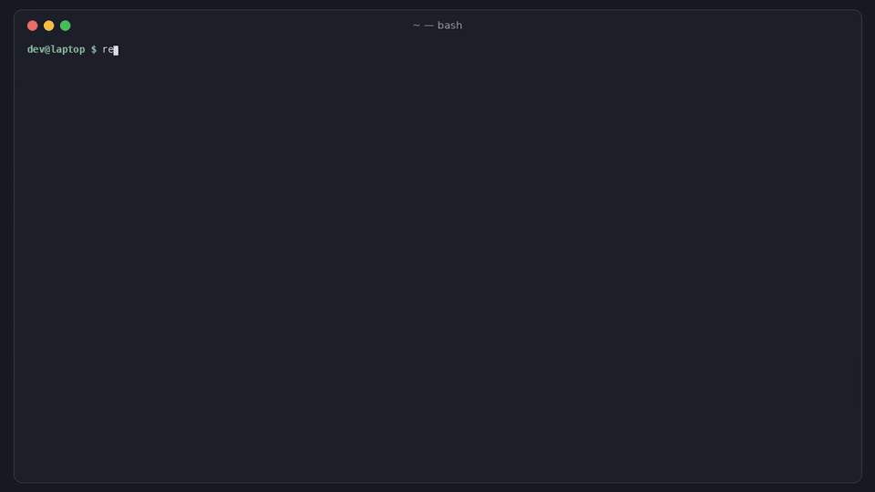

# revdeps

[](https://github.com/hamarshehmhmd/revdeps/actions/workflows/ci.yml)


[](LICENSE)

**Will my release break the projects that depend on me?** revdeps finds your most-used dependents, runs their
test suites against the version you have released today (baseline) and against your local, unreleased change
(candidate), and tells you which ones *you* would break: not the ones that were already red, not the flaky ones.



> 🎬 2-minute narrated demo: [demo.mp4](https://github.com/hamarshehmhmd/revdeps/releases/download/v0.1.0/demo.mp4)

```sh
curl -fsSL https://raw.githubusercontent.com/hamarshehmhmd/revdeps/main/install.sh | sh
```

## Why

Your own tests pass, semver says it's a minor, and you still break people, because they rely on behaviour you
never meant to promise ([Hyrum's law](https://www.hyrumslaw.com/)). The ecosystems that take this seriously
built their own tooling: Rust has [crater](https://github.com/rust-lang/crater), R has
[revdepcheck](https://github.com/r-lib/revdepcheck), Vite runs a hand-maintained
[ecosystem-ci](https://github.com/vitejs/vite-ecosystem-ci). If you maintain an npm or PyPI library, you usually
have nothing like it, so you find out from the issue tracker the morning after a release.

revdeps is that check as one small CLI:

- **discover**: the most-downloaded packages that depend on yours, with their repos (via [ecosyste.ms](https://packages.ecosyste.ms/))
- **run**: clone each dependent, install it, run its tests with the released library, swap in your build, run again
- **classify** every dependent: `ok`, `BROKEN` (passed before, fails with your change), `fixed`, `already failing`,
  `flaky` (failed once, passed on retry) or `error` (couldn't clone/install)
- **name the tests** that newly fail (and the assertion message) when the suite writes JUnit XML
- **report** in the terminal, as JSON, as Markdown for a PR comment, and in the GitHub Actions step summary

Exit code is 1 only when something is `BROKEN` (configurable), so it can gate a release.

## Install

One line (uses `uv tool`, then `pipx`, then a private venv):

```sh
curl -fsSL https://raw.githubusercontent.com/hamarshehmhmd/revdeps/main/install.sh | sh
```

Or directly:

```sh
pipx install git+https://github.com/hamarshehmhmd/revdeps
# or: pip install git+https://github.com/hamarshehmhmd/revdeps
```

Needs Python 3.9+ and git. For npm libraries you need Node.js + npm (pnpm/yarn are used when a dependent has
their lockfile and the tool is installed; otherwise revdeps falls back to npm). For PyPI libraries each dependent
gets a fresh virtualenv.

## Usage

```sh
cd my-library
revdeps discover --top 10 --write     # writes revdeps.toml with your top dependents
revdeps run                            # baseline vs candidate for each of them
```

```text
$ cd examples/npm && revdeps run
revdeps: testing 4 dependent(s) of slugkit (npm) — baseline vs candidate
✓ ok              blog-engine  baseline pass 0.2s → candidate pass 0.2s
✗ BROKEN          url-shortener  baseline pass 0.2s → candidate fail 0.2s
    newly failing (2):
      - short slug is capped at 12 chars  (Expected values to be strictly equal: + actual - expected + 'a-very-long-article-title-about-caching' - 'a-very-long')
      - short slug never ends with a dash  (The expression evaluated to a falsy value: assert.ok(short('Release notes for v2').length <= 12))
    log: examples/npm/.revdeps/logs/url-shortener.log
+ fixed           recipe-site  baseline fail 0.2s → candidate pass 0.2s
    newly passing (1): accented recipe names
· already failing legacy-cms  baseline fail 0.2s → candidate fail 0.2s

4 dependents: 1 broken, 1 ok, 1 fixed, 1 already failing
```

Useful flags for `revdeps run`:

| flag | what it does |
|---|---|
| `-j 4` | test 4 dependents in parallel (default 2) |
| `--only a,b` | just these dependents |
| `--retries N` | re-run a newly failing candidate N times to separate flakes (default 1) |
| `--candidate-only` | skip the baseline run: faster, but can't tell "you broke it" from "already broken" |
| `--json out.json` / `--markdown out.md` | machine-readable results / PR-comment table |
| `--fail-on broken,error,flaky` | which statuses make the exit code 1 (default `broken`) |
| `--keep` | keep the checkouts (in your temp dir) for debugging |

Full logs for every step are in `.revdeps/logs/<dependent>.log`.

### revdeps.toml

```toml
[library]
ecosystem = "npm"            # or "pypi"; auto-detected from package.json / pyproject.toml
path = "."                   # your library checkout (the candidate)
# build = "npm run build"    # run once before packing

[defaults]                   # applies to every dependent unless overridden
timeout = 900

[[dependent]]
name = "serve-index"
repo = "https://github.com/expressjs/serve-index.git"
# ref = "v1.9.1"             # branch, tag or commit
# subdir = "packages/core"   # monorepos
# install = "npm ci"         # default: npm ci / pnpm / yarn / npm install, by lockfile
# inject = "npm install --no-save {tarball}"
# test = "npm test"
# env = { TZ = "UTC" }

[[dependent]]
name = "my-app"
path = "../my-app"           # a local checkout instead of a repo
```

Placeholders you can use in commands: `{tarball}` (your packed npm build), `{lib}` (your library path),
`{python}` (the dependent's venv Python), `{junit}` (where to write JUnit XML), `{workdir}`, `{config_dir}`.

Defaults:

| | npm | PyPI |
|---|---|---|
| install | `npm ci` (falls back to `npm install`), or pnpm/yarn by lockfile | `{python} -m pip install -e . pytest` |
| inject | `npm install --no-save {tarball}` (from `npm pack` of your library) | `{python} -m pip install --force-reinstall --no-deps {lib}` |
| test | `npm test` | `{python} -m pytest --junitxml={junit}` |

To get test names for npm projects, point the test command at a JUnit reporter, e.g.
`node --test --test-reporter=spec --test-reporter-destination=stdout --test-reporter=junit --test-reporter-destination={junit}`
or `npx jest --reporters=default --reporters=jest-junit` with `JEST_JUNIT_OUTPUT_FILE={junit}`.

### GitHub Actions

```yaml
- uses: actions/setup-node@v4
  with: { node-version: 22 }
- uses: hamarshehmhmd/revdeps@v0.1.0
  with:
    config: revdeps.toml
    args: --jobs 4
```

The Markdown table lands in the job summary and `revdeps-results.json` in the workspace.
Running it on a `release/*` branch or a nightly schedule works well; a full run is as slow as your dependents'
test suites.

## Demo

Try the bundled examples (no network needed for the npm one):

```sh
git clone https://github.com/hamarshehmhmd/revdeps && cd revdeps/examples/npm
revdeps run            # slugkit 2.0.0-dev vs four apps that use slugkit 1.0.0
cd ../pypi && revdeps run
```

The npm example's "change" renames an option (`maxLength` → `limit`) and fixes accent handling, so you see one
dependent break, one get fixed, one stay fine and one that was already failing for unrelated reasons.

A real-world check run while building this: in a checkout of [escape-html](https://github.com/component/escape-html),
`&` was changed to escape as `&#38;` instead of `&amp;` (same meaning in HTML), then `revdeps discover --write`
and `revdeps run` tested its top 6 dependents. revdeps flagged
[serve-index](https://github.com/expressjs/serve-index) as BROKEN (its tests assert on `&amp;`), the other
dependents stayed green, and jest-html-reporters showed as already failing because its tests need yarn.

## Limits (honest list)

- Only npm and PyPI today. The runner is generic, so other ecosystems work with custom `install`/`inject`/`test`.
- npm injection replaces the top-level copy of your package. Dependents that only get it through another package
  keep their nested copy; use `inject` with npm `overrides` for those.
- Dependents whose tests need services (databases, browsers, secrets) need their own `install`/`test`/`env` setup.
- It runs other people's code (their install scripts and tests) on your machine. Run it in CI or a container
  if you don't trust the dependents.
- Discovery is a starting point: ecosyste.ms data can be stale, and repos without a public URL are skipped.

## Development

```sh
pip install -e . pytest
pytest -q                     # npm example tests need node >= 20; set REVDEPS_LIVE=1 to also hit ecosyste.ms
```

## License

[GNU AGPL-3.0-or-later](LICENSE). Commercial licenses without the AGPL obligations are available from the author,
Mohammad Hamarsheh (open an issue or contact via [GitHub](https://github.com/hamarshehmhmd)).
